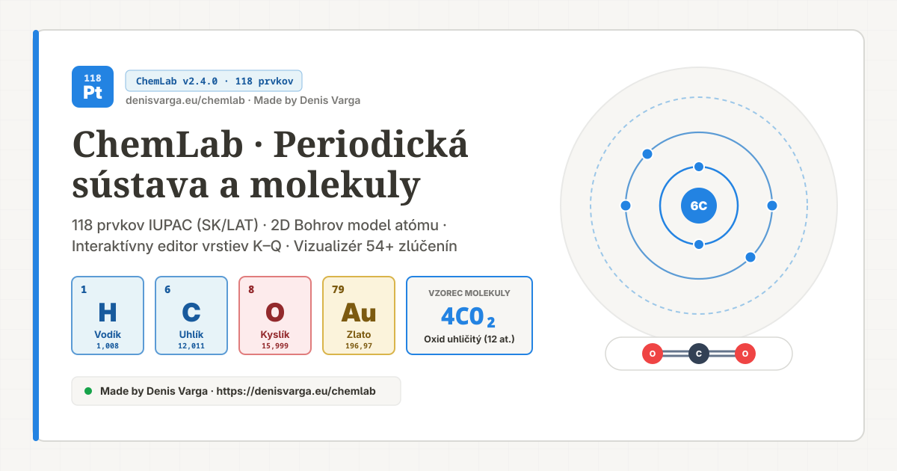
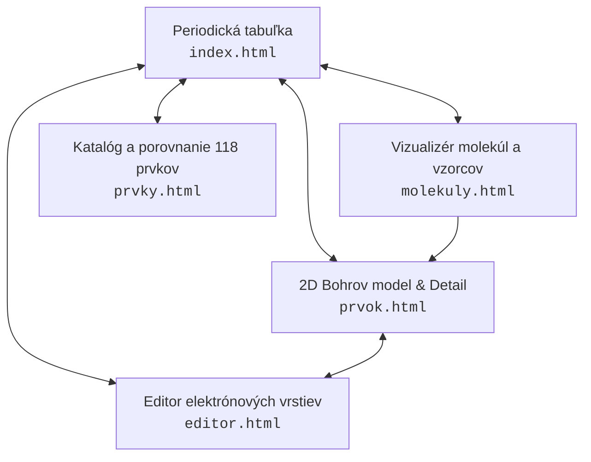

<div align="center">

# 🧪 ChemLab — Interaktívne chemické laboratórium

**Vedecky presná, moderná webová aplikácia pre chémiu, periodickú sústavu prvkov a vizualizáciu molekúl.**

[](https://denisvarga.eu/chemlab/)
[](https://denisvarga.eu/chemlab/#H)
[](https://denisvarga.eu/chemlab/molekuly.html#4CO2)
[](https://denisvarga.eu/chemlab/)
[](https://fontawesome.com/)
[](package.json)
[](https://denisvarga.eu)

🌐 **Živá aplikácia (Live Demo):** [https://denisvarga.eu/chemlab/](https://denisvarga.eu/chemlab/)

<br>

<a href="https://denisvarga.eu/chemlab/">
  
</a>

</div>

---

## 📖 Obsah

- [O projekte](#-o-projekte)
- [Hlavné moduly aplikácie](#-hlavné-moduly-aplikácie)
  - [1. Periodická tabuľka prvkov (`index.html`)](#1-periodická-tabuľka-prvkov-indexhtml)
  - [2. 2D Bohrov model atómu a detail prvku (`prvok.html`)](#2-2d-bohrov-model-atómu-a-detail-prvku-prvokhtml)
  - [3. Interaktívny 2D editor elektrónových vrstiev (`editor.html`)](#3-interaktívny-2d-editor-elektrónových-vrstiev-editorhtml)
  - [4. Molekuly a zlúčeniny — Chemical Formula Visualizer (`molekuly.html`)](#4-molekuly-a-zlúčeniny--chemical-formula-visualizer-molekulyhtml)
  - [5. Katalóg a porovnanie prvkov (`prvky.html`)](#5-katalóg-a-porovnanie-prvkov-prvkyhtml)
- [Dizajn a používateľská skúsenosť](#-dizajn-a-používateľská-skúsenosť)
- [Klávesové skratky](#-klávesové-skratky)
- [SEO, Open Graph a bezpečnosť](#-seo-open-graph-a-bezpečnosť)
- [Architektúra a štruktúra súborov](#-architektúra-a-štruktúra-súborov)
- [Inštalácia a lokálny vývoj](#-inštalácia-a-lokálny-vývoj)
- [História vydaní (Changelog)](#-história-vydaní-changelog)
- [Autor a licencia](#-autor-a-licencia)

---

## 🔬 O projekte

**ChemLab** je digitálne vzdelávacie chemické laboratórium a encyklopédia postavená na čistom **HTML5, CSS3 a modernom JavaScript (ES moduly)** bez akýchkoľvek ťažkých runtime frameworkov.

Projekt prepája exaktné dáta Medzinárodnej únie pre čistú a aplikovanú chémiu (**IUPAC**) s vysoko intuitívnym interaktívnym prostredím. Študentom, učiteľom aj nadšencom chémie umožňuje skúmať štruktúru atómov, upravovať elektrónové vrstvy priamo na dráhach v reálnom čase, zadávať chemické vzorce a okamžite sledovať rozpad látok na atómy, výpočty molárnych hmotností aj ich reálnu geometriu.

### Kľúčové piliere projektu:
- **100 % vedecká presnosť**: Všetkých 118 prvkov vrátane reálnych izotopov, 20 Madelungových výnimiek elektrónovej konfigurácie a overených dát.
- **Slovenské aj latinské názvoslovie**: Dôsledné zobrazenie oboch vedeckých názvov (napr. *Vodík / Hydrogenium*, *Zlato / Aurum*, *Kyselina sírová / Acidum sulfuricum*).
- **Notion + Wikipedia štýl**: Pokojná paleta farieb Notion, typografia s pätkovými titulkami a štruktúrované prehľady pre maximálnu čitateľnosť.
- **Nulové runtime závislosti**: Extrémne rýchle načítanie a plynulý chod na desktope aj mobilných zariadeniach.

---

## 🚀 Hlavné moduly aplikácie

Aplikácia je navrhnutá ako viacstránkový systém (Multi-Page Architecture), v ktorom má každá sekcia dedikovanú stránku a možnosť priameho prepojenia pomocou URL hash kotiev (napr. `#Au`, `#4CO2`).



---

### 1. Periodická tabuľka prvkov (`index.html`)

- **Kompletná 18-stĺpcová mriežka**: Štandardné IUPAC rozloženie všetkých 118 chemických prvkov od vodíka ($Z = 1$) po oganesón ($Z = 118$), vrátane oddelených lantanoidov a aktinoidov.
- **Dvojjazyčné označenie buniek**: Každá bunka prehľadne zobrazuje protónové číslo, značku, slovenský názov, latinský názov a relatívnu atómovú hmotnosť.
- **Filtrovanie a zvýrazňovanie**:
  - Filtrovanie podľa 10 kategórií (alkalické kovy, kovy alkalických zemín, prechodné kovy, lantanoidy, aktinoidy, kovy p-bloku, polokovy, nekovy, halogény, vzácne plyny).
  - Filtrovanie skupenstva pri STP (pevné, kvapalné, plynné, neznáme).
  - Zvýraznenie konkrétnej skupiny ($1\text{–}18$) alebo periódy ($1\text{–}7$).
- **Okamžité inteligentné vyhľadávanie**: Funguje podľa slovenského názvu (aj bez diakritiky), latinského názvu, značky prvku alebo protónového čísla.
- **Plávajúci informačný tooltip**: Zobrazuje rýchle fyzikálno-chemické parametre pri prechode myšou.

---

### 2. 2D Bohrov model atómu a detail prvku (`prvok.html`)

- **Animovaný rovinný 2D model**:
  - Plynule rotujúce elektróny po kruhových dráhach s fyzikálne odvodenými rýchlosťami podľa hlavného kvantového čísla $n$.
  - Presné obsadenie vrstiev $K, L, M, N, O, P, Q$ s rešpektovaním všetkých 20 konfigurácií s výnimkou (napr. $\text{Cr}, \text{Cu}, \text{Pd}, \text{Ag}, \text{Pt}, \text{Au}$).
- **Celoobrazovkový režim (Fullscreen mode)**: Možnosť zväčšiť model atómu na celú obrazovku pre vyučovanie a interaktívne prezentácie.
- **Ploché 2D jadro**: Vizuálne znázornenie protónov ($p^+$) a neutrónov ($n^0$) prispôsobené vybranému izotopu.
- **Inšpektor izotopov**: Prepínanie medzi stabilnými a rádioaktívnymi izotopmi s okamžitým prepočtom počtu neutrónov ($N = A - Z$).
- **Vedecká infobox tabuľka (Wikipedia štýl)**: Elektrónová konfigurácia (skrátená aj plná), elektronegativita, oxidačné stupne, atómový polomer, ionizačná energia, teploty topenia a varu, hustota a rok objavu.

---

### 3. Interaktívny 2D editor elektrónových vrstiev (`editor.html`)

- **Priama manipulácia klikaním na plátno**:
  - Kliknutie na prázdne miesto na dráhe pridá elektrón (`+1 e⁻`).
  - Kliknutie na rotujúci elektrón ho odstráni (`−1 e⁻`).
- **Tvorba a diagnostika iónov v reálnom čase**:
  - Okamžitý prepočet celkového náboja atómu ($Q = Z - \sum e^-$).
  - Klasifikácia: **Neutrálny atóm**, **Kladný ión — Katión** alebo **Záporný ión — Anión**.
- **Dynamická správa vrstiev ($K$ až $Q$)**:
  - Pridávanie nových vrstiev a bezpečné odstraňovanie vrstiev s ochranou pred nechcenou stratou elektrónov.
- **Vedecký validátor konfigurácie**:
  - Kontrola maximálnej kapacity vrstvy ($2n^2$).
  - Upozornenie na excitovaný stav (neobsadené vnútorné vrstvy) a nestabilný pomer nukleónov.
  - História úprav (`Späť` / `Dopredu`) a predvoľby bežných prvkov a iónov.

---

### 4. Molekuly a zlúčeniny — Chemical Formula Visualizer (`molekuly.html`)

- **Inteligentné zadávanie čísel v editore**:
  - **Číslo bez Shiftu**: Vkladá bežné číslo — stechiometrický **koeficient** pred vzorcom (napr. `4` v `4CO₂`).
  - **Shift + číslo**: Vloží typografický **dolný index** (napr. `₂` v `H₂O` alebo `Al₂(SO₄)₃`) s kontextovou kontrolou platnej pozície kurzora.
  - Prepínač režimu: **Auto** / **Koeficient** / **Dolný index** pre použitie na mobilných zariadeniach a dotykových displejoch.
- **Robustný parser chemických vzorcov**:
  - Podpora koeficientov (`4CO2`, `2H2O`), dolných indexov (`CO₂`), jednoduchých i vnorených zátvoriek s násobiteľmi (`Ca(OH)2`, `Al2(SO4)3`), organických zlúčenín (`CH3COOH`, `CO(NH2)2`) a hydrátov (`CuSO4·5H2O`).
  - Striktné rozlišovanie veľkosti písmen (`Co` — kobalt vs. `CO` — oxid uhoľnatý).
- **Rozsiahla databáza 54+ overených látok**:
  - Rozbaľovací výber v hlavičke rozdelený na molekulové a iónové zlúčeniny.
  - Podrobné textové vysvetlenie pre študentov aj odborníkov, história, využitie a zaujímavosti.
- **Interaktívna vizualizácia geometrie**:
  - Reprezentácia atómov sférami s chemickými značkami v štandardných CPK/Notion farbách a prepájanie väzbami.
  - Prepínač zobrazenia: **Všetky molekuly** (pri koeficiente $> 1$) vs. **Jedna molekula**.
  - Možnosť rotácie, približovania a kliknutia na atóm pre otvorenie jeho detailu.
- **Presný stechiometrický rozpis**:
  - Tabuľka počtov atómov v jednej jednotke aj celkovo po započítaní koeficientu.
  - Výpočet celkovej molárnej hmotnosti v $\text{g/mol}$ a presných hmotnostných percent jednotlivých prvkov.

---

### 5. Katalóg a porovnanie prvkov (`prvky.html`)

- **Porovnanie 3 prvkov vedľa seba**: Možnosť vybrať ľubovoľnú trojicu prvkov a priamo porovnať ich kategóriu, hmotnosť, vrstvy, elektrónovú konfiguráciu, elektronegativitu aj teplotu topenia.
- **Zoraditeľná tabuľka všetkých 118 prvkov**: Radenie podľa protónového čísla (vzostupne/zostupne), slovenského názvu, latinského názvu, atómovej hmotnosti, elektronegativity či teploty topenia.

---

## 🎨 Dizajn a používateľská skúsenosť

Projekt využíva estetiku inšpirovanú **Notionom a Wikipédiou**:
- **Farebná paleta Notion**:
  - Teplý papierový podklad (`#f7f6f3`), čistá biela (`#ffffff`), bridlicový atramentový text (`#37352f`) a Notion modrá (`#2383e2`).
  - 10 originálnych pastelových farieb Notion štítkov pre 10 chemických kategórií periodickej tabuľky.
- **Prehľadná Wikipedia typografia**:
  - Pätkové písmo (`Georgia`, `serif`) pre hlavné nadpisy chemických látok a prvkov.
  - Štruktúrované infoboxy, tabuľky a prehľadné karty vlastností.
- **Vektorové ikony Font Awesome 6**:
  - Všetky pôvodné emoji boli nahradené čistými vektorovými ikonami Font Awesome 6 Free.
- **Svetlý a tmavý režim**: Plnohodnotná podpora tmavého motívu so zachovaním kontrastu a čitateľnosti textu.
- **Kompaktná pätička (Footer)**: Zobrazuje verzie (`v1.0.0` až `v2.4.0`), podpis **Made by Denis Varga**, rýchlu navigáciu a ovládanie ochrany osobných údajov.

---

## ⌨️ Klávesové skratky

| Klávesová skratka | Akcia v aplikácii | Stránka |
| :--- | :--- | :--- |
| `↑` `↓` `←` `→` | Pohyb po bunkách periodickej tabuľky | `index.html` |
| `[` / `]` | Prepnutie na predchádzajúci / nasledujúci prvok podľa $Z$ | `index.html`, `prvok.html` |
| `/` | Okamžité zameranie vyhľadávacieho poľa | `index.html`, `prvky.html` |
| `R` | Výber náhodného chemického prvku / vzorca | Všetky stránky |
| `P` | Pozastavenie / spustenie rotácie 2D modelu atómu | `index.html`, `prvok.html` |
| `Esc` | Zrušenie aktívnych filtrov a vyhľadávania / zatvorenie modálneho okna | Všetky stránky |
| `Číslo` (bez Shiftu) | Vloženie normálnej číslice / koeficientu (napr. `4`) | `molekuly.html` |
| `Shift + Číslo` | Vloženie dolného indexu za prvok alebo zátvorku (napr. `₂`) | `molekuly.html` |

---

## 🛡️ SEO, Open Graph a bezpečnosť

- **Kompletné SEO**: Každá z 5 stránok má unikátny `<title>`, `<meta name="description">`, kľúčové slová, autorský tag a kanonickú URL adresu.
- **Open Graph & Twitter Cards**: Všetky stránky obsahujú `og:title`, `og:description`, `og:image` a `twitter:card`. Pre sociálne siete bol vygenerovaný oficiálny náhľadový obrázok **1200 × 630 px** ([`assets/og-image.png`](assets/og-image.png) a vektorový zdroj [`assets/og-image.svg`](assets/og-image.svg)).
- **Robots & Sitemap**:
  - [`robots.txt`](robots.txt): Nastavenie indexácie a odkaz na mapu stránok.
  - [`sitemap.xml`](sitemap.xml): Kompletná XML mapa všetkých stránok pre vyhľadávače.
- **Ochrana súkromia (Privacy Policy)**: Aplikácia nepoužíva žiadne reklamné, sledovacie ani analytické cookies tretích strán. Využíva výhradne lokálne úložisko prehliadača (`localStorage`) na uloženie zvolenej témy a potvrdenie cookie banneru.

---

## 📁 Architektúra a štruktúra súborov

```text
chem-lab/
├── index.html                  # Modul 1: Periodická tabuľka prvkov
├── prvok.html                  # Modul 2: 2D Bohrov model atómu a detail prvku
├── editor.html                 # Modul 3: Interaktívny 2D editor elektrónových vrstiev
├── molekuly.html               # Modul 4: Molekuly a zlúčeniny (Formula Visualizer)
├── prvky.html                  # Modul 5: Katalóg všetkých 118 prvkov a porovnanie
├── robots.txt                  # SEO inštrukcie pre vyhľadávače
├── sitemap.xml                 # XML mapa stránok pre vyhľadávače
├── package.json                # Nastavenia projektu a skripty
├── README.md                   # Kompletná dokumentácia projektu
├── assets/
│   ├── favicon.svg             # Vektorová ikona aplikácie
│   ├── og-image.svg            # Vektorový zdroj Open Graph bannera (1200x630)
│   └── og-image.png            # Rastrový Open Graph obrázok pre sociálne siete
├── scripts/
│   ├── dev-server.js           # Lokálny vývojový HTTP server s live reloadom
│   ├── build.js                # Produkčný build skript (generuje priečinok dist/)
│   └── validate.js             # Testy dát IUPAC, parsera vzorcov a HTML stránok
└── src/
    ├── main.js                 # Vstupný modul pre index.html
    ├── detail-page.js          # Vstupný modul pre prvok.html
    ├── editor-page.js          # Vstupný modul pre editor.html
    ├── molecules-page.js       # Vstupný modul pre molekuly.html
    ├── catalog-page.js         # Vstupný modul pre prvky.html
    ├── data/
    │   ├── elements.js         # Overená databáza 118 prvkov IUPAC (SK + LAT)
    │   └── compounds.js        # Databáza 54+ chemických zlúčenín a 3D geometrií
    ├── lib/
    │   └── formula-parser.js   # Parser vzorcov, stechiometria a Shift+číslo logika
    ├── components/
    │   ├── periodic-table.js   # Komponent interaktívnej periodickej tabuľky
    │   ├── element-details.js  # Komponent detailných informácií a vlastností prvku
    │   ├── atom-model.js       # Komponent animovaného 2D Bohrovho modelu
    │   ├── atom-editor.js      # Komponent 2D interaktívneho editora vrstiev
    │   ├── molecule-visualizer.js # Komponent vizualizácie molekúl na plátne
    │   └── site-chrome.js      # Globálna pätička, cookie banner a modálne okná
    └── styles/
        ├── main.css            # Globálne štýly, Notion paleta, navbar a pätička
        ├── table.css           # Štýly periodickej tabuľky a buniek prvkov
        ├── atom.css            # Štýly 2D Bohrovho modelu atómu a fullscreen režimu
        ├── editor.css          # Štýly interaktívneho editora elektrónových vrstiev
        ├── molecules.css       # Štýly vizualizéra vzorcov a molekúl
        └── catalog.css         # Štýly katalógu a porovnávacej tabuľky
```

---

## 💻 Inštalácia a lokálny vývoj

Projekt vyžaduje iba [Node.js](https://nodejs.org/) (verzia 18 alebo novšia). Nevyžaduje žiadne externé `npm` balíčky pre beh.

### 1. Spustenie validačných testov
Overí integritu všetkých 118 prvkov IUPAC, štruktúru súborov, databázu zlúčenín a parser chemických vzorcov:
```bash
npm test
```

### 2. Spustenie lokálneho vývojového servera
Spustí lokálny HTTP server na porte `4173`:
```bash
npm run dev
```
Následne otvorte adresu **[http://localhost:4173](http://localhost:4173)** vo vašom webovom prehliadači.

### 3. Vytvorenie produkčného buildu
Skopíruje všetky produkčné súbory do priečinka `dist/` a pripraví aplikáciu na nasadenie:
```bash
npm run build
```

Pre otestovanie vygenerovaného priečinka `dist/`:
```bash
npm run preview
```

---

## 📜 História vydaní (Changelog)

- **`v2.4.0` (Október / November 2026)**
  - Pridaný **Chemical Formula Visualizer** (`molekuly.html`) s inteligentným vkladaním čísel (`Shift + číslo = dolný index`).
  - Rozšírená databáza zlúčenín na **54+ overených látok** s rozbaľovacím filtrom kategórií.
  - Implementovaný **Fullscreen režim** pre 2D Bohrov model atómu.
  - Prechod na **Notion + Wikipedia dizajnový systém** a oficiálnu farebnú paletu Notion.
  - Kompletná výmena emoji za vektorové ikony **Font Awesome 6 Free**.
  - Pridaná nová **kompaktná pätička**, Cookie Banner a Zásady ochrany osobných údajov.
  - Implementované **SEO meta tagy**, vlastný Open Graph obrázok `og-image.png`, `robots.txt` a `sitemap.xml`.
- **`v2.0.0` (2026)**
  - Prechod na 5-stránkovú modulárnu architektúru s priamymi URL hash kotvami (`#H`, `#Au`, `#4CO2`).
  - Kompletné slovenské aj latinské vedecké názvoslovie pre všetkých 118 prvkov IUPAC.
  - Premiestnenie výberových filtrov z navigácie do prehľadných panelov na stránke.
- **`v1.5.0` (2026)**
  - Interaktívny 2D editor elektrónových vrstiev ($K$ až $Q$) s priamym klikaním na dráhy a elektróny.
  - Okamžitý prepočet iónového náboja atómu a vedecká diagnostika stability.
  - Katalóg prvkov s porovnávaním 3 vybraných prvkov vedľa seba.
- **`v1.0.0` (2026)**
  - Prvotné stabilné vydanie interaktívnej 18-stĺpcovej periodickej tabuľky 118 prvkov.
  - Animovaný rovinný 2D Bohrov model atómu a základná tabuľka vlastností.

---

## 👨‍💻 Autor a licencia

- **Autor a vývojár projektu:** **Denis Varga**
- **Osobná webstránka:** [https://denisvarga.eu](https://denisvarga.eu)
- **ChemLab online:** [https://denisvarga.eu/chemlab/](https://denisvarga.eu/chemlab/)
- **Licencia:** Vydané pod otvorenou licenciou [MIT](LICENSE).

<div align="center">
  <sub>ChemLab · Vytvorené s dôrazom na vedu, čistý kód a používateľskú prívetivosť.</sub>
</div>
